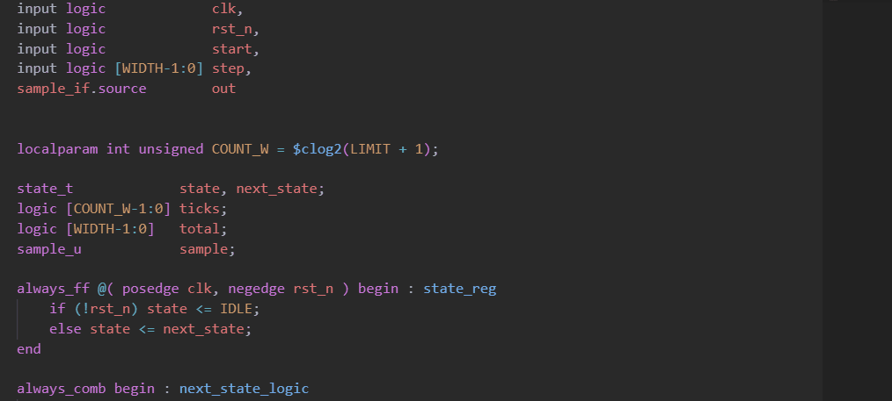
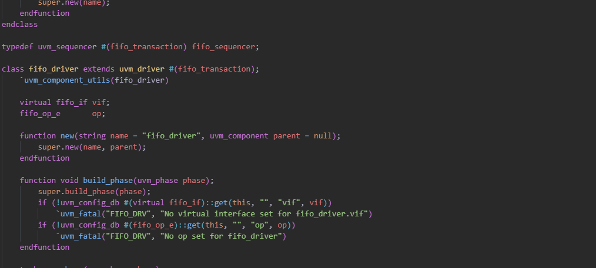
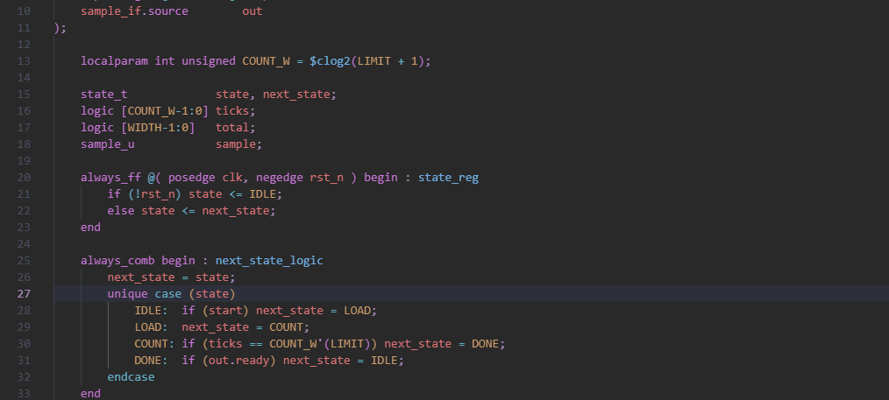

# Adel's Grimoire

Explains SystemVerilog keywords and UVM names where you read them. Hover a word to see what it does, the rules that apply to it and a worked example, without leaving your code.



## Features

### Keyword help on hover

Hover any of the 248 SystemVerilog keywords, such as `always_ff`, `begin`, `constraint` or `throughout`, to see what it does, the rules that apply to it and a short example. Closing keywords lead to the keyword they close: `end` opens `begin`, `endmodule` opens `module`.


### UVM help on hover

Hover a UVM class, macro, method, phase or constant, such as `uvm_config_db`, `` `uvm_info ``, `build_phase` or `UVM_ACTIVE`, to see what it is, its declaration, a worked example and the usual pitfalls. Nearly 200 pages cover the base classes, phasing and objections, the factory, the configuration database, sequences, TLM, reporting, the register layer and the command-line options.

Variations lead to the right page: `` `uvm_do_with `` opens the `` `uvm_do `` page, `uvm_analysis_imp_wr` opens `` `uvm_analysis_imp_decl ``, and `pre_reset_phase` opens `reset_phase`.

UVM pages only appear in SystemVerilog files.



### Animated hovers

For 105 words, the hover ends with a short looping animation that acts out its code example. Each wire flashes gold the moment its signal changes, so you can watch cause and effect:

- **Registers and logic:** `always_ff` passes `d` to `q` only on a clock edge and clears it on reset; `always_comb`, `assign` and `always_latch` follow their inputs; the gates and tri-state gates cycle through their inputs.
- **Edges:** `posedge`, `negedge` and `edge` draw a waveform and light the edges they react to.
- **Processes:** `fork` with `join`, `join_any` and `join_none` runs its threads side by side; `event`, `wait` and `wait_order` show a blocked process waking up.
- **Branching:** `if`, `case`, `casez`, `unique` and `priority` light the branch that runs.
- **Assertions:** `assert`, `throughout`, `until`, `eventually` and others are checked cycle by cycle, once passing and once failing.
- **UVM:** the phase order, objections, the sequence to driver handshake, analysis ports, TLM FIFOs and active and passive agents.

Animations match your color theme, with separate versions for light and dark themes.



### UVM ready for slang

Slang needs to find a UVM library to complete UVM code and to check it without errors. When a workspace uses UVM and slang is not set up for it yet, Grimoire sets it up for you, using the first of:

1. the folder chosen with **Grimoire: Set UVM Path**,
2. the `UVM_HOME` environment variable,
3. the UVM bundled with Grimoire ([Accellera UVM 2020.3.1](https://github.com/accellera-official/uvm-core), Apache 2.0).

It adds the UVM location to the workspace's `.slang/local/server.json`, which is slang's file for settings that belong to one machine, alongside a `.gitignore` that keeps it out of your repository, and restarts slang. Workspaces that do not use UVM, or that already point slang at a UVM library, are left alone.

Grimoire's page also stays above slang's own hover when both have something to show.

### Slang config for your project

By default slang checks every SystemVerilog file in the workspace, including build output and third-party IP. **Grimoire: Create Slang Config** writes `.slang/server.json`, slang's shared project config, with the folders slang should skip. It lists the folders that hold SystemVerilog and checks build output and vendored code, meaning folders with their own `LICENSE`, `COPYING` or `.git`, then opens the file and restarts slang. A workspace that already has `.slang/server.json` is left alone. The UVM location stays in `.slang/local/server.json`, so the shared file can be committed.

### UVM snippets

Type `transaction` in a SystemVerilog file and pick `transaction_uvm` to insert a ready-made `uvm_sequence_item` class. Type the name once, such as `fifo`, and it fills in `fifo_transaction` everywhere. Press Tab to move on to the data width, each field name and the delay limit; each name is filled in everywhere it is used. The suggestion shows the class's Grimoire page and the code it inserts.

Type `sequence` and pick `wr_sequence_uvm` or `rd_sequence_uvm` for a write or read sequence of those transactions, with random `num_items` and `max_delay` knobs that set how many items it sends and the largest `delay` they get.

The rest of a two-sided VIP, such as a FIFO with a write side and a read side, comes from these snippets. Each takes the same name. Snippets for one side come as a `wr_` and an `rd_` pair; the others cover both sides, which default to `wr` and `rd`:

| Snippet | Inserts |
| --- | --- |
| `if_uvm` | Interface with signals and driver and monitor clocking blocks for both sides |
| `pkg_uvm` | VIP package that imports UVM and includes every file in order |
| `sequencer_uvm` | Sequencer `typedef` for the transaction |
| `wr_driver_uvm`, `rd_driver_uvm` | Driver that waits for reset, then drives each item after its `delay`; the write driver also drives the data |
| `wr_monitor_uvm`, `rd_monitor_uvm` | Monitor that samples each transfer and writes it to its analysis port, with `accepted` from `full` or `empty` |
| `wr_agent_uvm`, `rd_agent_uvm` | Agent with sequencer, driver and monitor, building the driver only when active |
| `scoreboard_uvm` | In-order scoreboard: values from one side must come back from the other in the same order |
| `env_uvm` | Environment with both agents and the scoreboard, connected |

Names passed to UVM macros get the same colors as where they are declared: the field in `` `uvm_field_int `` and the other `` `uvm_field_* `` macros is colored as a variable, and the class in `` `uvm_object_utils ``, `` `uvm_component_utils ``, their `_begin` and `_param` forms and `` `uvm_declare_p_sequencer `` as a class. The constraint and assertion keywords `inside`, `dist`, `with`, `soft`, `intersect`, `within` and `first_match` are colored as keywords too.

### Your own pages

Add a folder of Markdown pages, such as your team's coding rules or notes on in-house IP, and they appear on hover next to the built-in ones.

## Setup

1. Install the [Slang extension](https://marketplace.visualstudio.com/items?itemName=hudson-river-trading.vscode-slang), which Grimoire requires.
2. Install Adel's Grimoire.

The SystemVerilog and UVM pages are built in, so hover help works straight away.

## Commands

| Command | What it does |
| --- | --- |
| **Grimoire: Set UVM Path** | Choose the UVM library slang uses, or go back to automatic: `UVM_HOME`, else the bundled UVM. Shows which one is in use. |
| **Grimoire: Create Slang Config** | Write `.slang/server.json` with the folders slang should not check. |
| **Grimoire: Disable** | Turn off Grimoire's hovers and its slang setup. |
| **Grimoire: Enable** | Turn them back on. |

## Settings

| Setting | Default | What it does |
| --- | --- | --- |
| `grimoire.enabled` | `true` | Show Grimoire's hovers and keep slang pointed at a UVM library. |
| `grimoire.uvmPath` | `""` | UVM library for slang, as the UVM folder or its `src` folder. Empty uses `UVM_HOME`, else the bundled UVM. |
| `grimoire.libraryPaths` | `[]` | Extra documentation folders, searched before the built-in pages. |

## Adding your own pages

A library folder holds subfolders, and each subfolder holds one folder per word, named after it, with the page inside as `<name>/<name>.md`. A plain `<name>.md` file also works. List the library folder in `grimoire.libraryPaths`:

```json
"grimoire.libraryPaths": ["/path/to/my-library"]
```

- The `sv` and `uvm` subfolders apply only to SystemVerilog files.
- Any other subfolder applies everywhere.
- A page in your folders wins over a built-in page with the same name.
- The first line of a page is its title, written as ``**`name`** — summary``.
- A line of `---` draws a separator between parts of a page, such as the description, the code example and an animation, with space above and below it.
- Pages can show images, GIFs and animated SVGs saved next to them in the word's folder. Refer to the file by name with a markdown image, or with an HTML `img` tag when you want to set its `width`.
- To match light and dark themes, save two files with `.dark` and `.light` before the extension, and refer to the name without it. A page that shows `behavior.svg` gets `behavior.dark.svg` in dark and high contrast themes, and `behavior.light.svg` in light themes.

A subfolder can also hold an `aliases.json` file that points other names at an existing page. Keys are names or `*` globs, values are page names, and the first match wins:

```json
{
  "uvm_component_utils_end": "uvm_component_utils_begin",
  "uvm_analysis_imp_*": "uvm_analysis_imp_decl"
}
```

A page for the exact name always wins over an alias, and a leading backtick is ignored, so `` `uvm_info `` finds `uvm_info.md`.

## Adding your own snippets

A subfolder can also hold a `snippets` folder of `<trigger>.snippet` files. The file name is what you type, and a snippet in your folders wins over a built-in one with the same name. Each file has a `page:` line naming the page shown with the suggestion, a `---` line, then the code in [VS Code snippet syntax](https://code.visualstudio.com/docs/editor/userdefinedsnippets#_snippet-syntax):

Optional `needs:` lines name lines the code depends on. Any that the file does not have yet are added at its top, so slang finds UVM's macros and classes:

```text
page: uvm_sequence_item
needs: `include "uvm_macros.svh"
needs: import uvm_pkg::*;
---
class ${1:my}_transaction extends uvm_sequence_item;
  `uvm_object_utils(${1}_transaction)
endclass
$0
```

System tasks such as `$display` are inserted as written.

Optional `note:` lines are shown with the suggestion, with placeholders filled in, and are never inserted. Use them for setup the code relies on, such as `note: ${1}_vip_pkg compiled first`.
